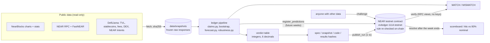

# NEAR Evidence Ledger

**Track: Investment Thesis (`thesis`, "Make the long-term case")** · NEAR HACKATHON 2026 · MIT license · NEAR **testnet** contract, no mainnet transaction

**The problem.** Investment theses about a chain are written as prose: "usage is growing", "revenue exists". Nobody can check them, and a dashboard that shows the number today can show another one tomorrow. **The Evidence Ledger turns a thesis into ten falsifiable claims, each with a numeric threshold fixed before the verdict. A program computes SUPPORTED / REFUTED / INCONCLUSIVE from public data, and a NEAR contract stores the verdict together with the hash of the exact data and code behind it, so that anyone can re-run it, compare it, and challenge it.** Several claims come out refuted, and that is shown first-class.

> **Other project from the same team: [Counterparty Guard](https://github.com/TODOUGLAS/counterparty-guard).** It is independent from this one (different repository, different track) and is disclosed here as required by rule Q-015. See also [below](#other-project-counterparty-guard).

## What is different (details: [`docs/COMPETITION.md`](docs/COMPETITION.md))

Messari, Token Terminal, Artemis, DefiLlama and Dune show metrics; UMA, Kleros and Chainlink settle questions by votes or trusted node networks; EAS stores arbitrary attestations. We found no public product that combines all of the following:

| | feature | where |
|---|---|---|
| 1 | claims with **thresholds fixed before the verdict**, in a machine-readable spec you can extend ([`claims/examples/`](claims/examples)) | `ledger/claims.py`, `ledger/custom.py` |
| 2 | **verdicts computed with 90% bootstrap intervals** (three-way, FEVER-style labels but numeric) | `ledger/claims.py` |
| 3 | **the verdict rule runs on-chain**: the contract rejects a verdict that contradicts its own value, interval and threshold | `contract/src/rule.rs` |
| 4 | **exact data + code are hash-committed** (`spec`, `snapshot`, `code`, `results` hashes) in one transaction | `publish_run` |
| 5 | **permissionless challenge by recomputation**: a challenger posts other data or another number, the contract computes the alternative verdict and records whether it flips | `challenge` |
| 6 | **pre-registered interval forecasts**, committed before the data exists (no backdating possible) and **scored on-chain** | `register_predictions`, `resolve`, `scoreboard` |
| 7 | **robustness of each verdict**: how far its threshold must move, and what other windows or another data source say (for example C3 flips to REFUTED on gas-only fees) | `ledger/robustness.py` |
| 8 | **one command re-checks the chain record** and a daily CI workflow runs it | `python -m ledger verify`, `.github/workflows/verify.yml` |

**Why NEAR.** Cheap, fast storage: on testnet, publishing the 10-verdict run, 21 forecasts and one challenge cost the publisher about 0.02 NEAR in storage and gas (the contract's own code is the main one-time cost); named accounts make the publisher and every challenger legible; the thesis itself is about NEAR (the claims read NEAR mainnet data, including NEAR Intents flow), and the registry lives on the same network.



## Try it (every step is "do X, see Y"; Python 3.11+, no API keys, no wallet)

```bash
python3 -m venv .venv && . .venv/bin/activate     # 1. isolated environment
pip install -r requirements.txt                    # 2. six pinned libraries
python -m ledger all --offline                     # 3. frozen data -> claims, forecasts, robustness, dashboard (~25 s cold, seconds cached)
python -m ledger test                              # 4. unit tests (no-leakage, verdict rule, hashes, robustness, custom claims)
python -m ledger verify                            # 5. re-run offline and compare with the on-chain record (reads testnet RPC, so needs network)
xdg-open site/index.html                           # 6. dashboard (macOS: open)
```

* **After step 3 you see** a `CLAIMS` table with ten rows `C1..C10` (verdict, value, 90% interval, threshold), a `BACKTEST` line, and the files `site/index.html`, `output/report.md`, `output/results.json`, `output/robustness.json`.
* **After step 5 you see** `MATCH` on `spec_hash`, `snapshot_hash`, `results_hash`, `code_hash`, one line per claim (`local` vs `chain` verdict and value), a line saying how many on-chain forecast intervals reproduce from the snapshot, and `RESULT: ALL MATCH`. A single changed byte in `data/snapshots` or one changed threshold turns that line into `MISMATCH`.
* **After step 6 you see** the claims table, a section "On-chain record" (contract, hashes, transaction links), a section "How fragile is each verdict?", then history, forecast fans, coverage bars, scenarios. Click any number to open its source; hover for the calculation and fetch date.
* `python -m ledger all` (without `--offline`) fetches fresh public data instead, so its numbers differ from the committed snapshot and from the chain record by design.

### Check, challenge, extend (NEAR testnet)

| do | command | you see |
|---|---|---|
| read the registry | `python -m ledger status` | the run, its hashes, the ten verdicts, challenges, the forecast scoreboard |
| re-check it | `python -m ledger verify` | `ALL MATCH` or the exact field that differs |
| dispute a verdict | `python -m ledger challenge --claim C3 --signer <your-testnet-account> --value 0.0003 --ci 0.0002 0.0004` (see `--help`; add `--dry-run` to only print) | a transaction link; `status` then shows `alt verdict ... (flips: True)` computed by the contract |
| add your own claim | `python -m ledger claim claims/examples/dex_volume_holds.json` | verdict, interval, `spec_hash` (pre-register that hash before the data moves) |
| score the forecasts | `python -m ledger resolve --signer <account>` after Mon 16.11 00:00 UTC | the first resolutions and hit/miss per interval (needs network) |

Signing uses `near-cli-rs` and keys in `~/.near-credentials`; no key is ever stored in this repository. `docs/deployment.json` names the contract; override with `LEDGER_CONTRACT` (testnet accounts only: the code refuses anything that does not end in `.testnet`).

<!-- ONCHAIN:BEGIN -->
## On-chain record (NEAR testnet)

* Contract: [`evledger-1114.testnet`](https://testnet.nearblocks.io/address/evledger-1114.testnet) (wasm sha256 `454756657be70f47...`). Publisher `evledger-pub-1114.testnet`, challenger `evledger-chal-1114.testnet`.
* Every transaction (account creation, deploys, run, challenge, forecasts) with its explorer link: [`docs/testnet_txs.tsv`](docs/testnet_txs.tsv).
* **Run #0** by `evledger-pub-1114.testnet` at block 277630672, data through 2026-11-08: [transaction](https://testnet.nearblocks.io/txns/2oGaJY8LrJjwu7VEB96JFyyJSAF53W6CUfFE5LNoyARj).
  * `spec_hash` `43a15ea320974e12a8bda5887d239525f67a6478b4a0a44bbdd4bb5dd03d157a`
  * `snapshot_hash` `351609889f50418942c5cd1f9d0b656a62c95da11e6e01c0986f8bcefee43407`
  * `code_hash` `abff4dbd87c267b760028ff94e4ffd2b6e4e5040d256fe8c6fe1471ef5dd7dc3`
  * `results_hash` `5570a5c12d94b1c5fa9ee64d905f454b7079d43213d5c4302f34eea8c01e040d`
* **Challenge #0** on C3 by `evledger-chal-1114.testnet`: alternative verdict REFUTED, flips the published one: **True**. This one is the project's own robustness variant (gas-only fees, same snapshot), filed from a separate account to show the mechanism; it is not an independent third-party dispute.
* **21 pre-registered 80% forecast intervals** (7 metrics x horizons 1, 2, 4 weeks), committed 2026-11-14T08:01:21Z for weeks that had not ended. Scoreboard at 2026-11-14T08:12:54Z: 0 resolved, 0 hits. First resolution possible Mon 2026-11-16 00:00 UTC.
<!-- ONCHAIN:END -->

<!-- EXAMPLE:BEGIN -->
### Example output (frozen snapshot, `python -m ledger all --offline`)

Data through the week ending 2026-11-08; the first ten snapshots were fetched 2026-11-13T23:53:07Z (UTC), the two NEAR Intents ones 2026-11-14T08:05:53Z. A fresh `python -m ledger all` uses newer data, so its numbers differ.

```text
== fetching public data (falls back to data/snapshots on any error) ==
  [snapshot] nb_charts       2026-11-13T23:53:07Z   1544022 B
  [snapshot] nb_stats        2026-11-13T23:53:08Z       478 B
  [snapshot] rpc_status      2026-11-13T23:53:11Z      4872 B
  [snapshot] rpc_validators  2026-11-13T23:53:14Z    378169 B
  [snapshot] fastnear_rpc    2026-11-13T23:53:14Z      4872 B
  [snapshot] dl_tvl          2026-11-13T23:53:14Z     68068 B
  [snapshot] dl_chains       2026-11-13T23:53:14Z     58107 B
  [snapshot] dl_stable       2026-11-13T23:53:15Z    368320 B
  [snapshot] dl_fees         2026-11-13T23:53:15Z    124885 B
  [snapshot] dl_intents_vol  2026-11-14T08:05:53Z     50729 B
  [snapshot] dl_intents_fees 2026-11-14T08:05:53Z     39204 B
  [snapshot] dl_dex          2026-11-13T23:53:15Z    207625 B
== analysis ==
weekly frame: 316 weeks, last complete week ending 2026-11-08
chain head check: rpc.mainnet.near.org 224435234 vs FastNEAR 224435241 (diff 7 blocks)

CLAIMS
------------------------------------------------------------------------------------------------
C1  REFUTED      value       0.15  90%CI [0.14, 0.19]             need >= 1.00  | Usage is not shrinking: median weekly transactions of the la
C2  REFUTED      value     71,159  90%CI [55,503, 79,464]         need >= 100,000  | The user base is large: median of weekly-median daily active
C3  SUPPORTED    value      1.86%  90%CI [1.57%, 2.29%]           need >= 1.00%  | Real revenue exists: fees paid on the NEAR chain (network + 
C4  SUPPORTED    value       1.54  90%CI [1.42, 1.75]             need >= 1.00  | DeFi liquidity holds: latest weekly TVL is at least its trai
C5  REFUTED      value       1.6%  90%CI n/a                      need >= 5.0%  | Stablecoin float is growing: stablecoin supply on NEAR is at
C6  REFUTED      value      -0.10  90%CI [-0.28, 0.13]            need >= 0.20  | Price tracks usage: over the last 52 weeks the correlation b
C7  INCONCLUSIVE value         10  90%CI n/a                      need >= 10  | Validation is decentralised: at least 10 validators are need
C8  SUPPORTED    value       2.5%  90%CI n/a                      need <= 5.0%  | Dilution is modest: total supply grew by at most 5% over the
C9  SUPPORTED    value       1.93  90%CI [1.68, 2.18]             need >= 1.00  | Intent flow keeps growing: median weekly NEAR Intents volume
C10  SUPPORTED    value     0.154%  90%CI [0.141%, 0.166%]         need >= 0.100%  | Intent flow monetises: fees DefiLlama attributes to NEAR Int

BACKTEST (conformal, mean over metrics): 80% interval covers 78% (h=4: 78%, h=12: 77%); 95% interval covers 92%

Open site/index.html  |  report: output/report.md  |  fetch log: output/FETCH_LOG.json
```
<!-- EXAMPLE:END -->

## The thesis and its ten claims

NEAR is an infrastructure bet on settlement flow for agents and intents, not on raw layer-1 transaction counts. It holds only if real fee revenue exists, liquidity and stablecoins stay, validation stays decentralised, dilution stays modest, and **intent flow keeps growing and pays a fee**. The risks are shrinking usage and a price that does not track usage. Thresholds are fixed in `ledger/claims.py` (rationale in `docs/THRESHOLDS_RATIONALE.md`); the verdict rule is in the docstring of that file and, in integer arithmetic, in `contract/src/rule.rs`.

| id | claim (short) | source ids |
|---|---|---|
| C1 | usage is not shrinking: median weekly txns, last 13 weeks vs the same weeks a year earlier, ratio ≥ 1.0 | `nb_charts` |
| C2 | median weekly-median daily active accounts, last 13 weeks, ≥ 100,000 | `nb_charts` |
| C3 | chain fees incl. protocols (DefiLlama), annualised, ≥ 1% of spot market cap | `dl_fees`, `nb_stats` |
| C4 | latest weekly TVL ≥ its trailing 52-week median | `dl_tvl` |
| C5 | stablecoins on NEAR grew ≥ 5% over 13 weeks | `dl_stable` |
| C6 | correlation of weekly log price change with weekly log change in active accounts (52 weeks) ≥ 0.2 | `nb_charts` |
| C7 | ≥ 10 validators needed to control 1/3 of stake | `rpc_validators` |
| C8 | total supply grew ≤ 5% in 52 weeks | `nb_charts` |
| C9 | NEAR Intents volume keeps growing: median weekly volume, last 13 weeks vs the 13 before, ratio ≥ 1.0 | `dl_intents_vol` |
| C10 | NEAR Intents monetise: attributed fees ≥ 0.10% of volume over 13 weeks | `dl_intents_vol`, `dl_intents_fees` |

## How it works

```
fetch (12 public endpoints, 20 s timeout, falls back to data/snapshots/ + logs it)
  -> weekly frame (ISO weeks; incomplete day/week dropped; flows summed, stocks end-of-week,
     active accounts = weekly median of the spiky daily series)
  -> claims: bootstrap (moving-block) 90% intervals -> computed verdicts (float rule, integer twin = on-chain rule)
  -> robustness: flip distance of each threshold + variants (other windows / statistic / data source)
  -> forecast: no-change centre + empirical quantiles of its own past h-step errors (split-conformal style);
     comparison: Gaussian random walk, quantile gradient boosting; rolling-origin backtest of coverage
  -> scenarios (p10/p50/p90, +12 weeks) and a tornado on  fees = txns x fee-per-txn x price
  -> hashes -> publish_run / register_predictions (NEAR testnet) -> verify / challenge / resolve
  -> site/index.html (Plotly, embedded, works offline) + output/report.md
```

| path | what |
|---|---|
| `contract/` | the registry (near-sdk 5.30, Rust 1.100 via `rust-toolchain.toml`): `src/lib.rs`, `src/rule.rs` (verdict rule), 19 unit tests incl. 480 vectors generated from Python (`tests/verdict_vectors.json`) |
| `ledger/claims.py`, `ledger/custom.py` | the claims, thresholds, verdict rule (float + integer twin); user-written claim specs |
| `ledger/chain.py`, `ledger/onchain.py` | canonical hashes, RPC views, near-cli transactions; `verify / publish / challenge / predict / resolve / status` |
| `ledger/robustness.py` | flip distance and variants per claim |
| `ledger/sources.py`, `ledger/data.py` | the twelve sources, fetch with snapshot fallback, tidy weekly frames |
| `ledger/forecast.py`, `ledger/scenarios.py` | interval methods, backtest, skill vs random walk, hyper-parameter grid; scenarios and tornado |
| `ledger/provenance.py`, `ledger/dashboard.py` | registry that links every shown number to a URL + fetch date; the HTML page |
| `data/snapshots/` | frozen copies of the raw responses (~3 MB) + `MANIFEST.json` with URL, time, sha256 |
| `docs/` | `COMPETITION.md`, `deployment.json`, `testnet_txs.tsv` (every transaction), `onchain.json` (registry copy shown on the dashboard), threshold rationale, KB sources, video script, X post, form checklist |

### Contract in one paragraph

`publish_run(run, verdicts)` stores four hashes and up to 32 verdicts (value, 90% interval, threshold, comparator, verdict, all fixed-point with 6 decimals) and aborts with `E_VERDICT` when a verdict contradicts the rule applied to its own numbers. `challenge(run_id, claim_id, alt_snapshot_hash, alt_value, alt_ci_lo, alt_ci_hi, alt_threshold, evidence)` is open to everyone and stores the alternative verdict that the contract computes, plus `flips`. `register_predictions` commits 80% intervals for weeks that have not ended (`E_TIME` otherwise); `resolve` is allowed only after the week ended; the first observation counts, a different later one is stored as a visible dispute (never an overwrite); `scoreboard` reports hits by the first observation and `hits_strict` (every observation inside the interval). Storage is paid by the caller; the excess deposit is refunded. Run the tests: `cd contract && cargo test --lib` (toolchain 1.100.0 is pinned).

## Honest limits (read before trusting any number)

* **Not an oracle, no cryptoeconomic security.** There are no bonds, no jurors, no slashing. A challenge is a public, machine-checked record, not a ruling. A malicious publisher could commit a fabricated snapshot: the defence is that anyone can re-fetch the same public APIs and compare. The snapshot hash proves *which bytes* were used, not that the API sent them (TLSNotary-style proofs are the obvious next step).
* **Testnet only**; one publisher account; the registry has not been audited. No mainnet transaction is made by this project.
* **The forecast track record starts empty on purpose.** 21 intervals were committed on 2026-11-14 for weeks ending 2026-11-15, 11-22 and 12-06. The first week closes after the submission deadline, so at submission the scoreboard shows 0 resolved; nothing can be backdated, and a retro-registration would be rejected by the contract. Resolve with `python -m ledger resolve`.
* **Verdict fragility is part of the output.** C7 sits exactly on its threshold (INCONCLUSIVE by rule). C3's SUPPORTED relies on DefiLlama's attribution of protocol fees to NEAR (gas-only fees give REFUTED). C5 and C9 depend on the window. See section 1c of the dashboard.
* **C9/C10 were added after the first eight** and the author had seen DefiLlama's 30-day Intents aggregates before fixing their thresholds (disclosed in `docs/THRESHOLDS_RATIONALE.md`); 10 bps is a low bar and C10 is not a hard test.
* Intents claims use DefiLlama's attribution of volume and fees, a third-party model that can change. The forecasts do not cover Intents series (only about 100 weekly points, too short for the backtest).
* Intervals under-cover a little (see the BACKTEST line and the dashboard table): the series changed regime several times, so past errors understate the future. The 95% level is closer to nominal than the 80% level.
* **The conformal intervals are not clearly better than the naive Gaussian random-walk baseline**; conformal needs no distribution assumption but on this short, regime-switching data it buys no measurable coverage advantage. Quantile gradient boosting under-covers most (data-hungry).
* **No model beat a no-change random walk on point accuracy.** The first candidate (damped trend) lost in 16 of 16 metric-horizon cells; the shipped model centres on "no change" and learns only the *width* from its own errors. That choice was made after seeing the backtest, so the reported coverage is mildly optimistic.
* Price is close to unpredictable. The ledger makes **no price call**; bear/bull are the 10th/90th percentiles, not stress cases.
* Cross-machine reproducibility: with the pinned libraries the offline run was bit-identical for `--jobs 1` and `--jobs -1` on the build box; `verify` tolerates 5 micro-units of float noise on values and treats `code_hash` / `results_hash` differences as warnings, not failures.
* Not investment advice.

## Disclosure (rule Q-005)

* **AI-written code.** All code and documents in this repository were written during the hackathon window (started 2026-11-13) by an AI coding assistant (Grok Bot) working for the team lead; the lead reviews and runs it. There is no pre-hackathon code.
* **Libraries:** numpy, pandas, scipy, scikit-learn (+ joblib), plotly (+ plotly.js embedded in the page), requests; Rust: near-sdk 5.30. Pinned in `requirements.txt` and `contract/Cargo.lock`.
* **Data:** NearBlocks, NEAR public RPC, DefiLlama, FastNEAR. No keys, no scraping, read-only GET/POST of public endpoints.
* **On-chain:** NEAR **testnet** only. The contract `evledger-1114.testnet` and two helper accounts were created for this project; their testnet funds came from another testnet account of the same team (the faucet was rate-limited). Keys stay in `~/.near-credentials` outside the repository.
* **Competitor and ecosystem facts** in `docs/COMPETITION.md` come from the linked public pages, read on 2026-11-14.
* **Methodology references** from the team's private knowledge base are cited with chunk ids in `docs/KB_SOURCES.md` and at the bottom of the dashboard.

## Other project: Counterparty Guard

**[Counterparty Guard](https://github.com/TODOUGLAS/counterparty-guard)** (+ AgentVault) is the team's other entry: a spending-limit contract and a pre-payment check for AI agents (tracks `security` and `agents`). It is a separate repository with its own README, which names this project in return. The two share no code and no data.

## License

MIT, see `LICENSE`.
